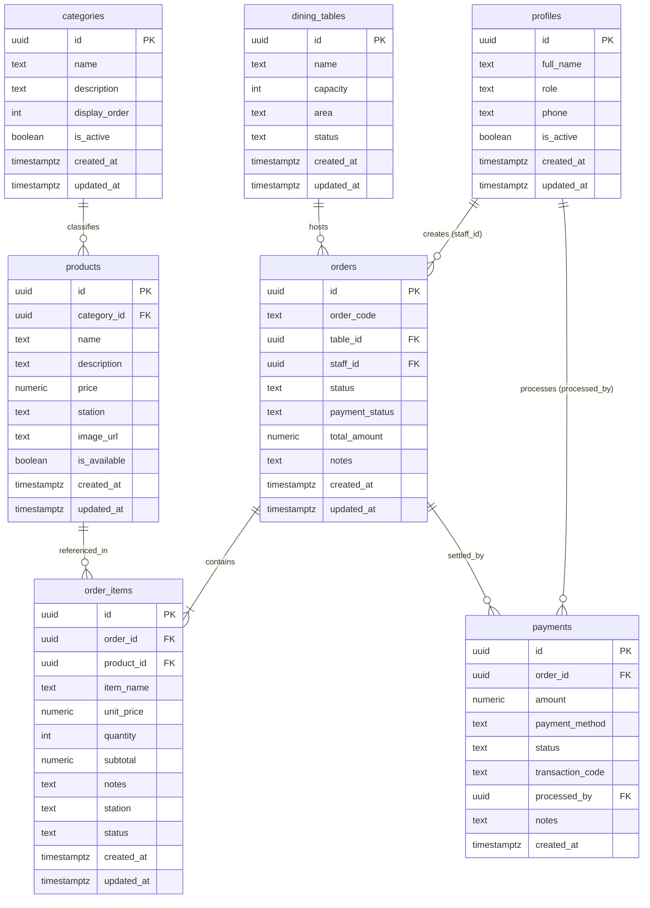

# TÀI LIỆU THIẾT KẾ CƠ SỞ DỮ LIỆU SMART ORDER (DATABASE DESIGN SPECIFICATION)

> **Dự án:** Smart Order (`order_app`)
> **Giai đoạn:** C1.1 — Hoàn thiện Database Design trước khi viết SQL
> **Hệ quản trị CSDL mục tiêu:** Supabase PostgreSQL (kèm Supabase Auth, RLS, Realtime)
> **Trạng thái tài liệu:** Bản thiết kế hoàn chỉnh chờ phê duyệt, chưa thực thi mã SQL vào CSDL.

---

## 1. TỔNG QUAN DỰ ÁN & KẾT QUẢ KHẢO SÁT MÃ NGUỒN HIỆN TẠI

### 1.1. Hiện trạng source code và dependencies
Qua khảo sát thực tế toàn bộ thư mục `lib/`, `test/` và file [`pubspec.yaml`](file:///c:/Flutter%20PJ/order_app/pubspec.yaml):
* **Dependencies hiện có:** Flutter SDK, `cupertino_icons: ^1.0.8`, `provider: ^6.1.5+1`, `intl: ^0.20.3`.
* **Backend:** Chưa tích hợp `supabase_flutter`. Ứng dụng hiện đang chạy 100% bằng dữ liệu mô phỏng trong bộ nhớ (in-memory state) trên các màn hình UI.
* **Cấu trúc dữ liệu hiện tại:**
  - [`lib/screens/staff/staff_screen.dart`](file:///c:/Flutter%20PJ/order_app/lib/screens/staff/staff_screen.dart): Quản lý `_tables` (List 12 Map), `_menuItems` (List Map), `_cart` (Map đối tượng `CartItemData`). Đã có bộ điều khiển số lượng `[ - ] qty [ + ]` và hộp thoại `OrderConfirmDialog`.
  - [`lib/screens/kitchen/kitchen_screen.dart`](file:///c:/Flutter%20PJ/order_app/lib/screens/kitchen/kitchen_screen.dart): Quản lý `_kitchenTickets` cục bộ với các trạng thái `pending`, `cooking`, `ready` và hộp thoại `StationConfirmDialog`.
  - [`lib/screens/bar/bar_screen.dart`](file:///c:/Flutter%20PJ/order_app/lib/screens/bar/bar_screen.dart): Quản lý `_barTickets` cục bộ với các trạng thái `pending`, `preparing`, `ready` và hộp thoại `StationConfirmDialog`.
  - [`lib/screens/admin/admin_screen.dart`](file:///c:/Flutter%20PJ/order_app/lib/screens/admin/admin_screen.dart): Hiển thị danh sách món ăn, danh sách bàn và các chỉ số KPI giả lập.

### 1.2. Bảng đối chiếu: Trạng thái In-Memory hiện tại vs Cơ sở dữ liệu mục tiêu

| Thành phần nghiệp vụ | Trạng thái In-Memory hiện tại (UI Demo) | Cấu trúc CSDL chuẩn hóa mục tiêu (PostgreSQL) |
| :--- | :--- | :--- |
| **Tài khoản người dùng** | Chưa có Auth; chọn vai trò qua `RolePickerScreen` | Bảng `profiles` liên kết `auth.users(id)` của Supabase |
| **Phân loại thực đơn** | Chuỗi text 'Bếp' / 'Bar' gắn cứng trong từng món | Bảng `categories` độc lập phân cấp danh mục |
| **Sản phẩm (Món/Nước)** | Mảng `_menuItems` gắn cứng trong code | Bảng `products` với giá `numeric(12, 2)`, trạm `station` ('kitchen'/'bar') |
| **Bàn ăn** | Mảng `_tables` lưu trong state của `StaffScreen` | Bảng `dining_tables` đồng bộ trạng thái thực tế qua Realtime |
| **Đơn gọi món** | Reset sạch giỏ hàng khi gửi đơn; không lưu vết | Bảng `orders` lưu mã đơn, bàn, nhân viên, trạng thái, tổng tiền |
| **Chi tiết món gọi** | Lưu tạm trong biến `_cart` | Bảng `order_items` lưu snapshot tên món, giá đặt, số lượng, trạm, ghi chú |
| **Thanh toán & Thu ngân** | Chưa có giao diện và logic thanh toán | Bảng `payments` ghi nhận dòng tiền, phương thức, thời gian, nhân viên thu |

---

## 2. SƠ ĐỒ THỰC THỂ LIÊN KẾT (ERD) ĐẦY ĐỦ 7 BẢNG

Mô hình dữ liệu bao gồm 7 bảng cốt lõi, bảo đảm tính toàn vẹn tham chiếu, khả năng mở rộng và hỗ trợ phân luồng riêng cho Bếp/Bar cũng như quy trình thanh toán:

---

## 3. ĐẶC TẢ CHI TIẾT 7 BẢNG DỮ LIỆU

### 3.1. Bảng `profiles` (Hồ sơ người dùng & Vai trò)
Lưu trữ thông tin nhân sự trong nhà hàng, đồng bộ trực tiếp với Supabase Auth (`auth.users`).
* **Bảo mật tuyệt đối:** Không chứa trường mật khẩu. Mật khẩu được mã hóa và quản lý bởi phân hệ Auth của Supabase.
* **Chính sách khóa ngoại:** `id REFERENCES auth.users(id) ON DELETE CASCADE`. Khi xóa user trên Supabase Auth, hồ sơ profile liên quan bị xóa; tuy nhiên trong vận hành thực tế sẽ dùng `is_active = false` để bảo toàn lịch sử giao dịch.

| Tên cột | Kiểu dữ liệu | Nullable | Mặc định | Ràng buộc / Constraints | Mô tả |
| :--- | :--- | :---: | :--- | :--- | :--- |
| `id` | `UUID` | NO | - | `PRIMARY KEY`, `REFERENCES auth.users(id) ON DELETE CASCADE` | Khóa chính, khớp với UUID tài khoản Auth |
| `full_name` | `TEXT` | NO | - | `CHECK (length(trim(full_name)) > 0)` | Họ và tên nhân viên |
| `role` | `TEXT` | NO | - | `CHECK (role IN ('admin', 'staff', 'kitchen', 'bar'))` | Vai trò truy cập hệ thống |
| `phone` | `TEXT` | YES | NULL | - | Số điện thoại liên lạc |
| `is_active` | `BOOLEAN` | NO | `true` | - | Trạng thái làm việc (vô hiệu hóa thay vì xóa) |
| `created_at` | `TIMESTAMPTZ`| NO | `timezone('utc'::text, now())` | - | Thời điểm tạo tài khoản |
| `updated_at` | `TIMESTAMPTZ`| NO | `timezone('utc'::text, now())` | - | Thời điểm cập nhật thông tin |

---

### 3.2. Bảng `categories` (Danh mục thực đơn)
Phân nhóm thực đơn phục vụ việc duyệt và lọc món ăn trên giao diện nhân viên và quản trị.

| Tên cột | Kiểu dữ liệu | Nullable | Mặc định | Ràng buộc / Constraints | Mô tả |
| :--- | :--- | :---: | :--- | :--- | :--- |
| `id` | `UUID` | NO | `gen_random_uuid()` | `PRIMARY KEY` | Khóa chính danh mục |
| `name` | `TEXT` | NO | - | `UNIQUE`, `CHECK (length(trim(name)) > 0)` | Tên danh mục (ví dụ: Món chính, Đồ uống) |
| `description`| `TEXT` | YES | NULL | - | Mô tả ngắn về danh mục |
| `display_order`| `INT` | NO | `0` | - | Thứ tự sắp xếp hiển thị trên giao diện |
| `is_active` | `BOOLEAN` | NO | `true` | - | Trạng thái hiển thị danh mục |
| `created_at` | `TIMESTAMPTZ`| NO | `timezone('utc'::text, now())` | - | Thời điểm tạo |
| `updated_at` | `TIMESTAMPTZ`| NO | `timezone('utc'::text, now())` | - | Thời điểm cập nhật |

---

### 3.3. Bảng `products` (Sản phẩm: Món ăn & Đồ uống)
Quản lý các mặt hàng kinh doanh trong thực đơn nhà hàng.
* **Chính sách giá tiền:** Sử dụng kiểu `NUMERIC(12, 2)` bảo đảm độ chính xác số học tuyệt đối.
* **Trạm chế biến (`station`):** Phân định rạch ròi món ăn do `kitchen` nấu hay đồ uống do `bar` pha chế.
* **Chính sách xóa:** Sử dụng cơ chế Soft Delete (`is_available = false`). `category_id REFERENCES categories(id) ON DELETE SET NULL` để không làm mất sản phẩm nếu danh mục bị xóa.

| Tên cột | Kiểu dữ liệu | Nullable | Mặc định | Ràng buộc / Constraints | Mô tả |
| :--- | :--- | :---: | :--- | :--- | :--- |
| `id` | `UUID` | NO | `gen_random_uuid()` | `PRIMARY KEY` | Khóa chính sản phẩm |
| `category_id`| `UUID` | YES | NULL | `REFERENCES categories(id) ON DELETE SET NULL` | Thuộc danh mục nào |
| `name` | `TEXT` | NO | - | `CHECK (length(trim(name)) > 0)` | Tên sản phẩm |
| `description`| `TEXT` | YES | NULL | - | Thành phần / mô tả món |
| `price` | `NUMERIC(12, 2)`| NO | - | `CHECK (price >= 0)` | Đơn giá niêm yết hiện tại |
| `station` | `TEXT` | NO | - | `CHECK (station IN ('kitchen', 'bar'))` | Trạm xử lý (Bếp hoặc Bar) |
| `image_url` | `TEXT` | YES | NULL | - | Link ảnh minh họa |
| `is_available`| `BOOLEAN` | NO | `true` | - | Còn phục vụ hay tạm hết hàng |
| `created_at` | `TIMESTAMPTZ`| NO | `timezone('utc'::text, now())` | - | Thời điểm tạo |
| `updated_at` | `TIMESTAMPTZ`| NO | `timezone('utc'::text, now())` | - | Thời điểm cập nhật |

---

### 3.4. Bảng `dining_tables` (Sơ đồ Bàn ăn)
Quản lý hiện trạng vật lý và bố trí không gian của nhà hàng.

| Tên cột | Kiểu dữ liệu | Nullable | Mặc định | Ràng buộc / Constraints | Mô tả |
| :--- | :--- | :---: | :--- | :--- | :--- |
| `id` | `UUID` | NO | `gen_random_uuid()` | `PRIMARY KEY` | Khóa chính bàn ăn |
| `name` | `TEXT` | NO | - | `UNIQUE`, `CHECK (length(trim(name)) > 0)` | Tên/Mã bàn (ví dụ: Bàn 01, VIP 02) |
| `capacity` | `INT` | NO | `4` | `CHECK (capacity > 0)` | Số ghế ngồi tối đa |
| `area` | `TEXT` | NO | `'Tầng 1'` | - | Khu vực (Tầng 1, Tầng 2, Sân vườn) |
| `status` | `TEXT` | NO | `'available'`| `CHECK (status IN ('available', 'occupied', 'reserved'))` | Trạng thái vật lý hiện tại của bàn |
| `created_at` | `TIMESTAMPTZ`| NO | `timezone('utc'::text, now())` | - | Thời điểm tạo bàn |
| `updated_at` | `TIMESTAMPTZ`| NO | `timezone('utc'::text, now())` | - | Thời điểm cập nhật |

---

### 3.5. Bảng `orders` (Đơn gọi món tổng hợp)
Đại diện cho một lượt gọi món/dùng bữa của khách tại một bàn cụ thể.
* **Nguyên tắc tổng hợp:** Một đơn hàng có thể chứa **đồng thời** cả món ăn (thuộc Kitchen) và đồ uống (thuộc Bar).
* **Khóa ngoại an toàn:**
  - `table_id REFERENCES dining_tables(id) ON DELETE RESTRICT`: Tuyệt đối không xóa bàn nếu đang có đơn hàng liên kết.
  - `staff_id REFERENCES profiles(id) ON DELETE RESTRICT`: Giữ nguyên lịch sử nhân viên tạo đơn.

| Tên cột | Kiểu dữ liệu | Nullable | Mặc định | Ràng buộc / Constraints | Mô tả |
| :--- | :--- | :---: | :--- | :--- | :--- |
| `id` | `UUID` | NO | `gen_random_uuid()` | `PRIMARY KEY` | Khóa chính đơn hàng |
| `order_code` | `TEXT` | NO | - | `UNIQUE`, `CHECK (length(trim(order_code)) > 0)` | Mã hiển thị dễ đọc (ví dụ: ORD-101) |
| `table_id` | `UUID` | NO | - | `REFERENCES dining_tables(id) ON DELETE RESTRICT` | Bàn ăn tương ứng |
| `staff_id` | `UUID` | YES | NULL | `REFERENCES profiles(id) ON DELETE RESTRICT` | Nhân viên mở đơn |
| `status` | `TEXT` | NO | `'pending'` | `CHECK (status IN ('pending', 'in_progress', 'completed', 'cancelled'))` | Trạng thái vòng đời đơn hàng |
| `payment_status` | `TEXT` | NO | `'unpaid'` | `CHECK (payment_status IN ('unpaid', 'partially_paid', 'paid', 'refunded'))` | Trạng thái thanh toán của đơn |
| `total_amount` | `NUMERIC(12, 2)`| NO | `0` | `CHECK (total_amount >= 0)` | Tổng tiền các món hợp lệ trong đơn |
| `notes` | `TEXT` | YES | NULL | - | Ghi chú chung cho đơn |
| `created_at` | `TIMESTAMPTZ`| NO | `timezone('utc'::text, now())` | - | Thời điểm khách gọi đơn |
| `updated_at` | `TIMESTAMPTZ`| NO | `timezone('utc'::text, now())` | - | Thời điểm cập nhật đơn |

---

### 3.6. Bảng `order_items` (Chi tiết từng món trong đơn)
Lưu chi tiết từng món được gọi, là đối tượng dữ liệu hiển thị trên màn hình KDS (Bếp) và BDS (Bar).
* **Cơ chế Snapshot:** Lưu trữ `item_name` và `unit_price` cố định tại thời điểm đặt, miễn nhiễm với việc Admin chỉnh sửa giá hoặc tên sản phẩm gốc trong tương lai.
* **Khóa ngoại:** `order_id REFERENCES orders(id) ON DELETE CASCADE`. Khi xóa đơn hàng (chỉ xảy ra khi hủy thử nghiệm ở môi trường test), các dòng chi tiết sẽ bị xóa theo; `product_id REFERENCES products(id) ON DELETE RESTRICT` ngăn xóa mất món gốc.

| Tên cột | Kiểu dữ liệu | Nullable | Mặc định | Ràng buộc / Constraints | Mô tả |
| :--- | :--- | :---: | :--- | :--- | :--- |
| `id` | `UUID` | NO | `gen_random_uuid()` | `PRIMARY KEY` | Khóa chính dòng món |
| `order_id` | `UUID` | NO | - | `REFERENCES orders(id) ON DELETE CASCADE` | Thuộc đơn hàng nào |
| `product_id` | `UUID` | YES | NULL | `REFERENCES products(id) ON DELETE RESTRICT` | Sản phẩm gốc tham chiếu |
| `item_name` | `TEXT` | NO | - | `CHECK (length(trim(item_name)) > 0)` | **Snapshot tên món** tại lúc gọi |
| `unit_price` | `NUMERIC(12, 2)`| NO | - | `CHECK (unit_price >= 0)` | **Snapshot đơn giá** tại lúc gọi |
| `quantity` | `INT` | NO | - | `CHECK (quantity > 0)` | Số lượng gọi món |
| `subtotal` | `NUMERIC(12, 2)`| NO | - | `CHECK (subtotal >= 0)` | Thành tiền dòng món (`unit_price * quantity`) |
| `notes` | `TEXT` | YES | NULL | - | Yêu cầu riêng (Ít cay, không đá...) |
| `station` | `TEXT` | NO | - | `CHECK (station IN ('kitchen', 'bar'))` | Trạm tiếp nhận chế biến |
| `status` | `TEXT` | NO | `'pending'` | `CHECK (status IN ('pending', 'preparing', 'ready', 'served', 'cancelled'))` | Trạng thái chế biến/phục vụ món |
| `created_at` | `TIMESTAMPTZ`| NO | `timezone('utc'::text, now())` | - | Thời điểm gọi món |
| `updated_at` | `TIMESTAMPTZ`| NO | `timezone('utc'::text, now())` | - | Thời điểm cập nhật tiến độ |

---

### 3.7. Bảng `payments` (Lịch sử giao dịch thanh toán)
Ghi nhận các giao dịch tài chính liên quan đến đơn hàng, hỗ trợ thu tiền một lần hoặc nhiều lần.
* **Quan hệ với `orders`:** `order_id REFERENCES orders(id) ON DELETE RESTRICT`. Không được phép xóa đơn hàng nếu đã phát sinh bản ghi giao dịch thanh toán.
* **Xác thực:** Giao dịch chỉ được đánh dấu là `completed` thông qua quy trình Backend (RPC hoặc Service có thẩm quyền), không tin tưởng trạng thái truyền tự do từ Client.

| Tên cột | Kiểu dữ liệu | Nullable | Mặc định | Ràng buộc / Constraints | Mô tả |
| :--- | :--- | :---: | :--- | :--- | :--- |
| `id` | `UUID` | NO | `gen_random_uuid()` | `PRIMARY KEY` | Khóa chính giao dịch |
| `order_id` | `UUID` | NO | - | `REFERENCES orders(id) ON DELETE RESTRICT` | Thanh toán cho đơn hàng nào |
| `amount` | `NUMERIC(12, 2)`| NO | - | `CHECK (amount > 0)` | Số tiền thực trả trong giao dịch này |
| `payment_method`| `TEXT` | NO | `'cash'` | `CHECK (payment_method IN ('cash', 'banking_qr', 'card'))` | Phương thức: Tiền mặt, Chuyển khoản QR, Thẻ |
| `status` | `TEXT` | NO | `'pending'` | `CHECK (status IN ('pending', 'completed', 'failed', 'refunded'))` | Trạng thái giao dịch thanh toán |
| `transaction_code`| `TEXT` | YES | NULL | - | Mã đối soát ngân hàng / POS (nếu có) |
| `processed_by` | `UUID` | YES | NULL | `REFERENCES profiles(id) ON DELETE RESTRICT` | Nhân viên thực hiện thu tiền |
| `notes` | `TEXT` | YES | NULL | - | Ghi chú thêm về giao dịch |
| `created_at` | `TIMESTAMPTZ`| NO | `timezone('utc'::text, now())` | - | Thời điểm giao dịch phát sinh |

---

## 4. TÁCH BIỆT BA HỆ THỐNG TRẠNG THÁI THEO ĐÚNG NGHIỆP VỤ

Hệ thống quản lý nhà hàng tuyệt đối không được gộp chung trạng thái chế biến với trạng thái thanh toán. Ba máy trạng thái (State Machines) sau đây hoạt động độc lập và có quy tắc ràng buộc logic rõ ràng:

### 4.1. Máy trạng thái 1: Trạng thái Vòng đời Đơn hàng (`orders.status`)
Phản ánh toàn bộ tiến trình từ lúc khách vào bàn đến khi rời đi:
1. `pending`: Đơn hàng vừa được nhân viên gửi, các món đang chờ Bếp/Bar tiếp nhận.
2. `in_progress`: Ít nhất một món đã được nhận nấu/pha (`preparing`) hoặc đã xong (`ready`).
3. `completed`: Đơn hoàn tất, khách đã dùng xong và thanh toán đầy đủ (`payment_status = 'paid'`).
4. `cancelled`: Toàn bộ đơn hàng bị hủy bỏ (khách đổi ý trước khi chế biến, sự cố).

### 4.2. Máy trạng thái 2: Trạng thái Chế biến từng món (`order_items.status`)
Phản ánh quy trình bếp/bar và phục vụ tại bàn:
1. `pending`: Món đang chờ ở hàng đợi của Bếp hoặc Bar.
2. `preparing`: Nhân viên Bếp bấm "Bắt đầu nấu" hoặc Bar bấm "Bắt đầu pha".
3. `ready`: Bếp/Bar bấm "Báo hoàn thành" $\rightarrow$ Món ăn/đồ uống đã đặt tại quầy xuất hàng.
4. `served`: Nhân viên phục vụ đã bưng đĩa/ly đến tận bàn cho khách.
5. `cancelled`: Món bị hủy riêng lẻ (ví dụ hết nguyên liệu, khách xin đổi món).

### 4.3. Máy trạng thái 3: Trạng thái Thanh toán (`orders.payment_status` & `payments.status`)
Phản ánh dòng tiền tài chính của đơn hàng:
1. `unpaid`: Đơn chưa được thanh toán đồng nào (mặc định ban đầu).
2. `partially_paid`: Khách thanh toán trước một phần (ví dụ đặt cọc hoặc chia bill thanh toán trước một nửa).
3. `paid`: Tổng tiền các bản ghi `payments` có trạng thái `completed` đã $\ge$ `orders.total_amount`.
4. `refunded`: Toàn bộ hoặc một phần tiền thanh toán đã được hoàn trả lại cho khách.

### 4.4. Ma trận phân biệt rõ ràng & Điều kiện chuyển trạng thái

> [!CAUTION]
> **Quy tắc bất biến:** Không bao giờ tự động coi đơn hàng là `completed` hoặc `paid` chỉ vì Bếp và Bar đã làm xong món ăn (`ready`)!

* **Phân biệt `ready` vs `served`:**
  - `ready` (Đã sẵn sàng): Món đang nằm ở quầy chờ ra món của Bếp/Bar. Trách nhiệm thuộc về nhân viên chế biến đã xong việc.
  - `served` (Đã phục vụ): Nhân viên chạy bàn đã bưng món đến trước mặt khách. Trách nhiệm thuộc về nhân viên phục vụ bàn.
* **Điều kiện đóng đơn (`orders.status` chuyển thành `completed`):**
  - Điều kiện 1: Tất cả món trong `order_items` phải ở trạng thái cuối (`served` hoặc `cancelled`), không còn món nào đang dở dang (`pending`, `preparing`, `ready`).
  - Điều kiện 2: Trạng thái thanh toán của đơn phải là `payment_status = 'paid'`.
* **Điều kiện giải phóng bàn (`dining_tables.status` chuyển về `available`):**
  - Chỉ khi đơn hàng tại bàn đó đã chuyển thành `completed` (hoặc `cancelled`), nhân viên dọn dẹp bàn xong và bấm giải phóng bàn.

---

## 5. QUY TẮC TÍNH TIỀN, TÍNH NHẤT QUÁN & CƠ CHẾ ĐẢM BẢO

### 5.1. Công thức tính toán
1. **Thành tiền dòng món:**
   $$\text{order\_items.subtotal} = \text{order\_items.unit\_price} \times \text{order\_items.quantity}$$
2. **Tổng tiền đơn hàng:**
   $$\text{orders.total\_amount} = \sum (\text{order\_items.subtotal}) \quad \text{với các món có } \text{status} \neq \text{'cancelled'}$$
   *Món bị hủy (`cancelled`) không được tính vào tổng tiền của khách.*

### 5.2. Đánh giá việc lưu trữ đồng thời `subtotal` và `total_amount`
* **Vấn đề lý thuyết:** Lưu trữ cả `subtotal` và `total_amount` là dạng dữ liệu dư thừa (denormalized data).
* **Đánh giá thực tế trong hệ thống F&B / POS:**
  - **CỰC KỲ CẦN THIẾT** vì hiệu năng: Màn hình phục vụ, màn hình quản trị và in hóa đơn liên tục truy vấn tổng tiền hàng trăm đơn hàng. Việc tính `SUM()` liên tục trên bảng lớn qua mạng sẽ gây trễ và nghẽn hệ thống.
  - **Cơ chế chống lệch số liệu (Consistency Guarantee):**
    - Cấp 1: Cột `subtotal` trong `order_items` được bảo vệ bằng ràng buộc `CHECK (subtotal = unit_price * quantity)`.
    - Cấp 2: Tại tầng Database, sử dụng **PostgreSQL Trigger** lắng nghe sự kiện `AFTER INSERT OR UPDATE OR DELETE` trên bảng `order_items` để tự động tính toán và cập nhật lại `orders.total_amount`. Mọi thay đổi về giá, số lượng, thêm món hoặc hủy món đều tự động phản ánh vào tổng tiền ngay lập tức, loại bỏ hoàn toàn khả năng lệch dữ liệu giữa client và backend.

### 5.3. Phân biệt Declarative Constraints vs Transaction / RPC

| Nghiệp vụ | Tầng xử lý | Cơ chế kỹ thuật |
| :--- | :--- | :--- |
| Đơn giá $\ge 0$, số lượng $> 0$, số tiền $> 0$ | Bảng dữ liệu | Ràng buộc `CHECK constraint` |
| Giá trị trạng thái chỉ nằm trong tập hợp cho phép | Bảng dữ liệu | Ràng buộc `CHECK (status IN (...))` |
| Bàn, sản phẩm, nhân viên phải tồn tại | Bảng dữ liệu | Ràng buộc `FOREIGN KEY` |
| Tự động tính lại `orders.total_amount` khi sửa món | Database Engine | PostgreSQL Trigger Function |
| Tự động cập nhật `updated_at` | Database Engine | PostgreSQL Trigger Function |
| Gửi đơn hàng (Tạo `orders` + chèn hàng loạt `order_items` + đổi bàn sang `occupied`) | Backend API | **Database Transaction / RPC** (Nguyên tử Atomicity: Thành công cùng lúc, hoặc rollback hoàn toàn nếu 1 bước lỗi) |
| Ghi nhận thanh toán (Tạo `payments` + kiểm tra đủ tiền + cập nhật `payment_status = 'paid'`) | Backend API | **Database Transaction / RPC** |

---

## 6. QUY TẮC BẢO TOÀN LỊCH SỬ & XÓA DỮ LIỆU (AUDIT & INTEGRITY)

1. **Ngăn chặn xóa vật lý sản phẩm:**
   - Khi một món không còn bán (ngừng kinh doanh hoặc hết nguyên liệu dài ngày), Admin cập nhật `products.is_available = false`.
   - Bảng `order_items` áp dụng `product_id REFERENCES products(id) ON DELETE RESTRICT`. Ngăn chặn việc thực hiện lệnh `DELETE` vật lý đối với bất kỳ sản phẩm nào đã từng phát sinh đơn hàng trong quá khứ.
2. **Snapshot độc lập cho món ăn:**
   - Dù giá trong bảng `products` có tăng từ 65.000đ lên 80.000đ, giá trong `order_items.unit_price` của các đơn cũ vẫn giữ nguyên 65.000đ.
3. **Bảo toàn thông tin nhân sự:**
   - Khi nhân viên nghỉ việc, Admin cập nhật `profiles.is_active = false`.
   - Các trường `orders.staff_id` và `payments.processed_by` dùng `ON DELETE RESTRICT` để không bao giờ mất thông tin nhân viên phụ trách thu tiền hay phục vụ.
4. **Không xóa đơn hàng đã thanh toán:**
   - Khóa ngoại `payments.order_id REFERENCES orders(id) ON DELETE RESTRICT` bảo đảm không thể xóa bất kỳ đơn hàng nào đã có dữ liệu giao dịch thanh toán.

---

## 7. BẢO MẬT & ĐỊNH HƯỚNG CHÍNH SÁCH ROW LEVEL SECURITY (RLS)

Dưới đây là thiết kế chính sách phân quyền dữ liệu mức hàng (RLS) dự kiến sẽ triển khai ở giai đoạn tiếp theo:

### 7.1. Bảng phân quyền nghiệp vụ (Permission Matrix)

| Bảng CSDL | Admin | Staff (Phục vụ) | Kitchen (Bếp) | Bar (Pha chế) |
| :--- | :---: | :---: | :---: | :---: |
| `profiles` | Toàn quyền (CRUD) | Xem thông tin bản thân (R) | Xem thông tin bản thân (R) | Xem thông tin bản thân (R) |
| `categories` | Toàn quyền (CRUD) | Xem danh mục (R) | Xem danh mục (R) | Xem danh mục (R) |
| `products` | Toàn quyền (CRUD) | Xem món còn bán (R) | Xem thực đơn (R) | Xem thực đơn (R) |
| `dining_tables` | Toàn quyền (CRUD) | Xem và đổi trạng thái bàn (R, U) | Xem sơ đồ bàn (R) | Xem sơ đồ bàn (R) |
| `orders` | Toàn quyền (CRUD) | Tạo đơn, xem đơn, sửa đơn (C, R, U) | Xem đơn liên quan món bếp (R) | Xem đơn liên quan món bar (R) |
| `order_items` | Toàn quyền (CRUD) | Tạo dòng món, xem, đổi sang `served` | **Chỉ xem & cập nhật món có `station = 'kitchen'`** | **Chỉ xem & cập nhật món có `station = 'bar'`** |
| `payments` | Toàn quyền (CRUD) | Tạo & xem phiếu thu theo phân quyền thanh toán | Không có quyền (Không xem/sửa) | Không có quyền (Không xem/sửa) |

### 7.2. Nguyên tắc an toàn phân quyền
* **Bếp & Bar:** Bếp không bao giờ truy vấn hoặc cập nhật nhầm các dòng `order_items` có `station = 'bar'` và ngược lại. Chính sách RLS sẽ lọc trực tiếp `USING (station = 'kitchen')` ở tầng database.
* **Quyền thực hiện thanh toán:** Không cấp mặc định cho tất cả vai trò. Chỉ Admin và Staff có quyền ghi dữ liệu vào bảng `payments`. Trạng thái `payment_status` của `orders` chỉ được thay đổi thông qua hàm thanh toán hợp lệ (RPC).

---

## 8. CÁC GIẢ ĐỊNH CHO PHIÊN BẢN ĐẦU TIÊN (GIAI ĐOẠN C1)

Để đảm bảo thiết kế mạch lạc, các giả định nghiệp vụ sau đây được xác định rõ:
1. **Xác thực:** Đăng nhập sử dụng tài khoản Email và Mật khẩu thông qua hệ thống Supabase Auth tiêu chuẩn.
2. **Quyền thu tiền:** Trong phiên bản đầu tiên, nhân viên phục vụ (Staff) được phép thực hiện xác nhận thanh toán trực tiếp tại bàn khi khách yêu cầu; Quản trị viên (Admin) có quyền giám sát toàn bộ giao dịch.
3. **Quy tắc hủy món:** Nhân viên phục vụ có thể gửi yêu cầu hủy món; món chỉ được phép hủy trực tiếp nếu còn ở trạng thái `pending`. Nếu món đã chuyển sang `preparing` (đang nấu/pha), hệ thống yêu cầu sự đồng ý xác nhận từ trạm chế biến hoặc quản lý.
4. **Quản lý sản phẩm:** Không sử dụng tính năng xóa vật lý (Hard Delete) trên sản phẩm mà sử dụng cờ ngừng bán `is_available = false`.
5. **Hình thức thanh toán:** Phiên bản đầu tiên ưu tiên thanh toán toàn bộ 1 lần (`payments.amount = orders.total_amount`); cấu trúc bảng `payments` thiết kế theo quan hệ 1-N sẵn sàng hỗ trợ mở rộng thanh toán nhiều lần hoặc tách hóa đơn trong tương lai.
6. **Mỗi bàn một lượt khách:** Tại một thời điểm, mỗi bàn chỉ có duy nhất một đơn hàng đang hoạt động (`status IN ('pending', 'in_progress')`). Khi đơn này hoàn tất, bàn mới được mở cho lượt khách tiếp theo.

*(Lưu ý: Các giả định này phục vụ định hình thiết kế cơ sở dữ liệu và chưa coi là chức năng đã được lập trình trên source code).*

---

## 9. DANH SÁCH CÁC QUYẾT ĐỊNH CẦN CHỐT TRƯỚC KHI VIẾT SQL Ở C2

Trước khi tiến hành viết file script migration SQL ở Giai đoạn C2, cần thống nhất các quyết định kỹ thuật sau:

1. [x] **Số lượng bảng:** Thống nhất chuẩn 7 bảng (`profiles`, `categories`, `products`, `dining_tables`, `orders`, `order_items`, `payments`).
2. [ ] **Mã đơn hàng (`order_code`):** Lựa chọn định dạng mã đơn tự động:
   - *Phương án A:* Mã tăng dần theo ngày (ví dụ: `ORD-20261017-001`, `ORD-20261017-002`).
   - *Phương án B:* Chuỗi ngắn ngẫu nhiên hoặc số thứ tự đơn giản (ví dụ: `#ORD-101`, `#ORD-102`).
3. [ ] **Mức độ phụ thuộc vào Database Function (RPC) ở C2:**
   - *Phương án A:* Viết sẵn các Stored Procedures / RPC Functions (`create_full_order`, `process_payment`, `update_item_status`) ngay trong script SQL để client Flutter gọi an toàn qua 1 lời gọi mạng duy nhất.
   - *Phương án B:* Viết bảng và trigger cơ bản trước, các thao tác nghiệp vụ phức tạp sẽ được gọi tuần tự từ Flutter Service.
4. [ ] **Bộ tài khoản mẫu khởi tạo sẵn trong script SQL:**
   - Bạn có muốn chuẩn bị sẵn 4 tài khoản seed data ứng với 4 vai trò trong script SQL không? (Ví dụ: `admin@smartorder.vn`, `staff@smartorder.vn`, `kitchen@smartorder.vn`, `bar@smartorder.vn`).